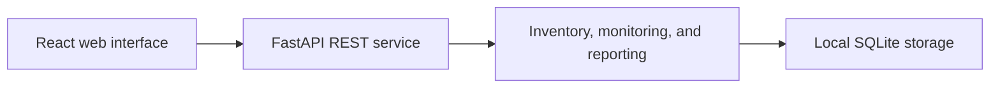
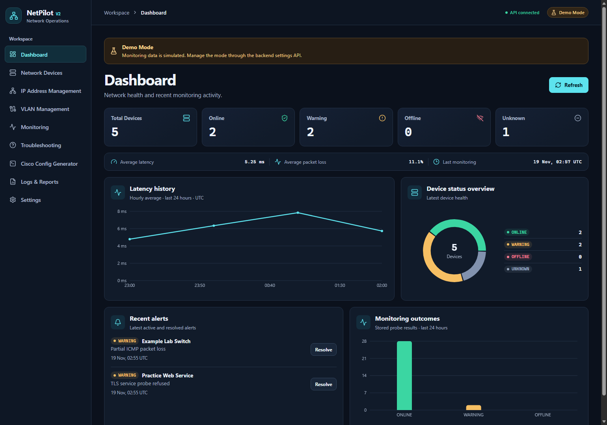

# NetPilot V2 Portfolio

NetPilot V2 is a Windows-first university project for learning network operations. The local application brings IPv4 inventory, VLAN planning, monitoring, and troubleshooting into one workspace. A learner can trace a dashboard alert back to a probe result, review possible causes, and choose the next check.

## Features

| Area | What the project demonstrates |
|---|---|
| Device inventory and IPAM | Register devices and IPv4 assignments, validate subnet boundaries, prevent overlaps, and track registered address use. |
| VLAN planning | Document access ports and 802.1Q trunks, including native and allowed VLANs, before making changes on equipment. |
| Monitoring | Review ICMP, DNS, and TCP results with latency, packet loss where applicable, and evidence age. |
| Troubleshooting | Review possible explanations and suggested checks alongside the observations that triggered the diagnosis. |
| Cisco IOS templates | Generate and explain lab configuration text for manual review. |
| Dashboard and reporting | Review health summaries and alerts, filter monitoring history, and export selected results. |

## Technology and architecture

The interface uses React, Vite, Tailwind CSS, and Recharts. A Python backend uses FastAPI and Pydantic for the REST API and SQLAlchemy with SQLite for local storage.

The monitoring view distinguishes between host reachability and individual service results. For example, a device can reply to ICMP while its configured TCP service refuses a connection. A missing or stale result can leave health unknown. IPAM utilization describes what is registered in the application. Availability in a report is based on sampled checks.

Demo Mode shows synthetic evidence without sending probes. Live Mode is intended for explicitly authorized targets in a local, single-operator environment. VLAN plans and generated IOS text are for review and manual application. The application source, tests, and internal engineering documentation are maintained in a private repository.

## Screenshots

These captures show Demo Mode with fictional lab labels and reserved IPv4 documentation addresses. The telemetry and configuration values are examples. [RFC 5737](https://www.rfc-editor.org/rfc/rfc5737)

- [Network device inventory](screenshots/network-devices.png)
- [IPv4 subnet utilization](screenshots/ipam.png)
- [VLAN and trunk planning](screenshots/vlan-management.png)
- [Monitoring evidence](screenshots/monitoring.png)
- [Troubleshooting a simulated TCP refusal](screenshots/troubleshooting.png)
- [Example Cisco IOS trunk template](screenshots/cisco-config-generator.png)
- [Simulated monitoring logs and report filters](screenshots/logs-reports.png)

## Demo video

A video link is pending. The screenshot walkthrough above follows the same sequence planned for the recording, from inventory and VLAN planning to probe evidence, troubleshooting, and reporting.
